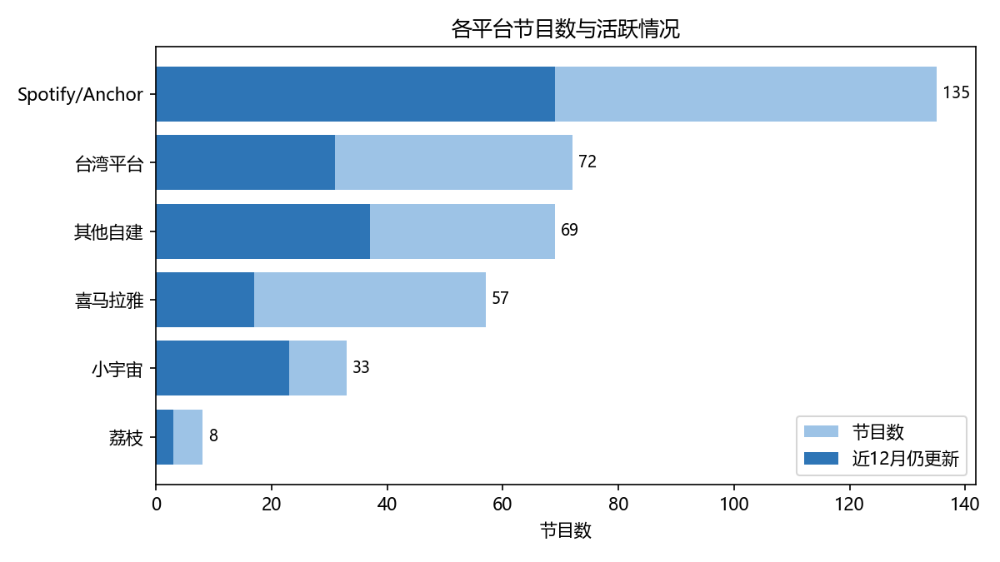
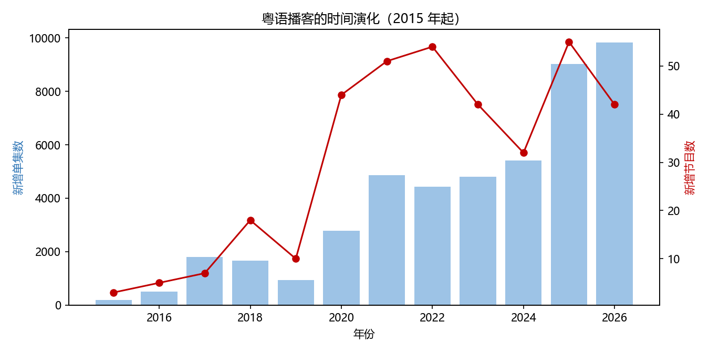
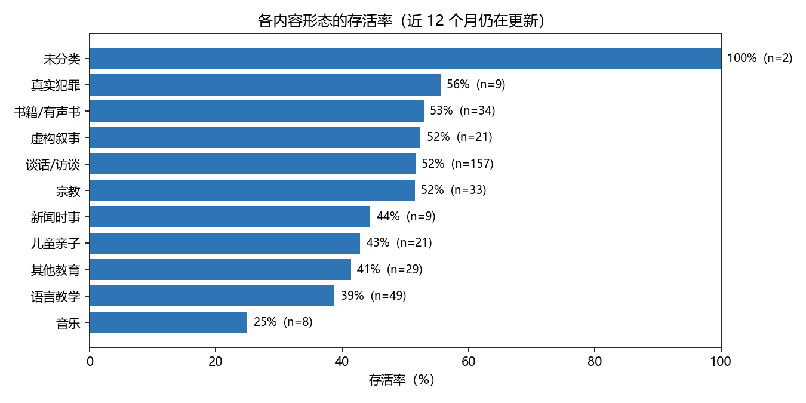
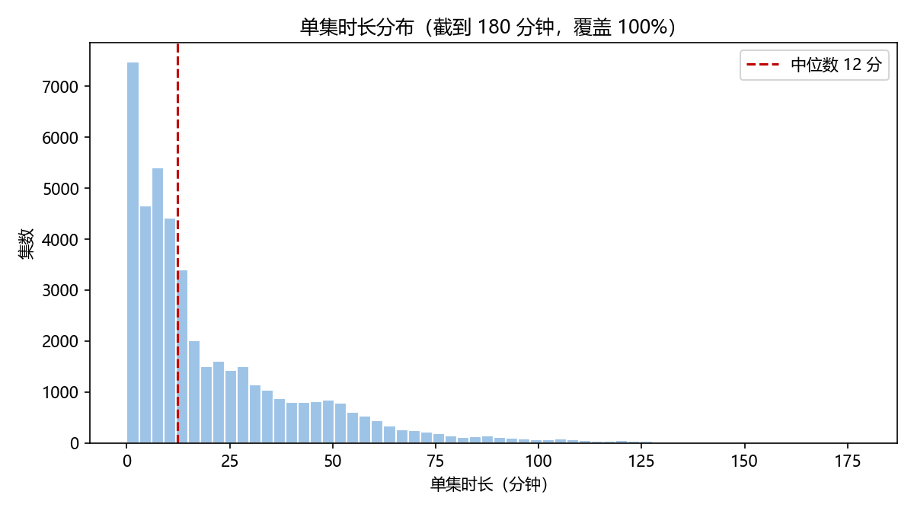
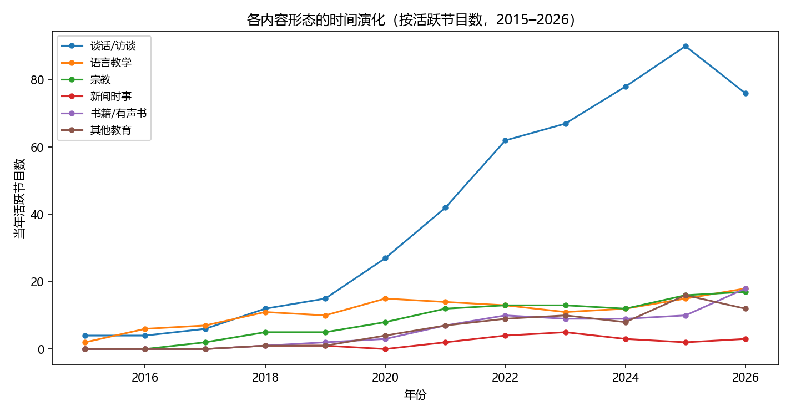

# 粤语播客生态分析报告

> 数据采集时间：2026-10
> 内容侧样本：374 档粤语播客 / 46,721 集单集
> 需求侧样本：喜马拉雅 57 档节目 / 13,595 集播放数据

---

## 摘要

本研究以苹果播客目录为抽样框，采集了 **374 档粤语播客、46,721 集单集**的元数据，并以喜马拉雅 57 档节目的**播放量**作为需求代理指标，试图回答一个问题：

> **粤语播客在讲什么，又有人在听什么？**

三个主要发现：

| # | 发现 | 关键数字 |
|:--:|------|------|
| **1** | **生态的死亡率远高于预期** | 51% 的节目近 12 个月未更新；19.5% 的节目活不过 10 集 |
| **2** | **供给结构在朝需求的反方向扩张** | 谈话类节目数从 4 涨到 90（占活跃六成），但单集播放只有全局的 0.22 倍 |
| **3** | **播放极度集中，"赢家通吃"** | 57 档节目中，前 3 档吃掉 86.6% 的播放量 |

**核心结论**：粤语播客不是一个均衡的播客市场，而是**由"教粤语"这一功能需求支撑的、其余部分高度自发的生态**。

---

## 一、研究背景与问题

### 1.1 为什么研究粤语播客

粤语是少数**同时具备"完整口语体系"和"明确传承焦虑"**的汉语方言。它有三个特点使其成为一个值得单独研究的播客子生态：

1. **有独立的文字习惯**——粤语书面语（嘅、咁、係）与普通话书面语有系统差异，不能直接互译
2. **跨越多个政治与平台边界**——广东、香港、澳门、海外华人社群，各自使用不同的平台
3. **语言态度存在张力**——既是"母语传承"的载体，也是"方言式微"的对象

这三点决定了粤语播客既不同于普通话播客，也不同于其他方言播客。

### 1.2 三个研究问题

| # | 问题 | 对应章节 |
|:--:|------|------|
| RQ1 | 粤语播客的供给结构是什么样的？ | 第三章 |
| RQ2 | 哪些内容真正被消费？ | 第四章 |
| RQ3 | 供给与需求之间是否存在错配？ | 第四章 |

---

## 二、数据与方法

### 2.1 抽样框：为什么用苹果播客目录

播客没有统一的中央目录：喜马拉雅、小宇宙、Spotify 各自封闭。唯一跨平台的公开索引是**苹果播客目录**——任何一个走标准 RSS 的播客，都会通过主播主动提交进入苹果目录。

因此本研究以苹果目录作为**抽样框（sampling frame）**，通过其公开的 iTunes Search API 检索：

```
https://itunes.apple.com/search?term={关键词}&entity=podcast&country={地区}&limit=100
```

**检索策略**：

| 维度 | 取值 |
|------|------|
| 关键词 | 粤语、廣東話、广东话、Cantonese、粤语播客、廣播劇、栋笃笑 |
| 地区 | cn、hk、tw、us |

共获得 **450 档节目、51,032 集单集**。

> **为什么必须跨地区检索**：香港、台湾商店上架的节目在 cn 商店中不可见。早期只搜 cn 时，大量香港节目完全检索不到。

### 2.2 语言判定

苹果目录里有大量"普通话节目顺带提到粤语"的噪声，因此逐条判定是否**主要以粤语讲述**。

判定规则（读节目名 + 简介 + 主播 + 平台）：

| 类型 | 判据 | 例 |
|------|------|------|
| **A 类（显式声明）** | 文本中出现 粤语 / 粵語 / 广东话 / 廣東話 / Cantonese | 「纯粤语探讨类节目」 |
| **B 类（粤语特征字）** | 出现 嘅、咁、係、喺、唔、嗰、啲、嘢、乜、睇、冇、咗、哋、佢、畀、嚟 | 「我哋一齐食饭」 |

- 命中任一 → 判为粤语
- 全部未命中 → 判为非粤语

**结果：374 档保留，74 档剔除**（另剔除 2 档重名《生命恩泉》）。

### 2.3 清洗

| 步骤 | 处理 | 结果 |
|------|------|------|
| 剔除非粤语 | 见 2.2 | 450 → 376 |
| 剔除重名 | 同一 RSS 地址重复收录 | 376 → 374 |
| 单集去重 | 按 (所属节目ID, 单集ID) | 51,032 → 46,721 |
| HTML/CDATA 剥离 | 简介多为富文本 | 5 项验证全部通过 |
| 繁简处理 | 定制转换（见下） | — |

> **繁简转换的技术坑**：通用的 OpenCC `t2s` 是为普通话设计的，会把粤语字改坏（係→系、嗰→𠮶、餸→𩠌）。本研究采用「转换前后双重保护」：转换前用占位符护住歧义字，转换后把落到扩展区的生僻异体字回填。实测 102,064 个字段，仅残余 2 个。

### 2.4 需求侧数据

播放量不是公开数据。经平台可行性测试，最终能拿到的只有**喜马拉雅**（57 档节目）与**小宇宙**（33 档，但只显示最新 15 期），因此选择喜马拉雅作为需求侧主样本。

最终采集 **57 档节目 / 13,595 集**的单集播放量、发布时间、时长。

### 2.5 分类体系

**这是本研究方法上反复调整的部分。**

苹果的 `<itunes:category>` 由主播自行选择，实测质量很差：「谈话/访谈」一个类占了 42%（157 档），里面混杂历史、科普、影评、瑜伽、TRPG、体育……本质是个垃圾桶。

因此做了**两套分类**：

| 用途 | 维度 | 类别 | 来源 |
|------|------|------|------|
| 生态画像 | **形式**（怎么讲） | 谈话/教学/朗读/演绎/儿童/宗教… | 苹果分类 + 逐条修正 |
| 供需矩阵 | **主题**（讲什么） | 语言教学/社会人文/自我成长/故事虚构/闲聊… | 对齐小宇宙、CPA 行业类目 |

**主题类别的行业依据**：小宇宙前台 19 类、CPA 中文播客社区 19 类、嘉世咨询 6 类，三者均以主题划分。本研究选取九类，在行业类目基础上合并，并保留两个粤语特有的类（语言教学、宗教灵性）。

> **主题标注的准确率说明**：57 档喜马拉雅节目为人工逐条判定；其余 317 档采用关键词规则判定（正负样本抽查准确率约 75%）。因此**主题分布可用于聚合分析，不宜单独引用某一档节目的判定结果**。

### 2.6 分析口径

播放量是**累计值**——2020 年的单集已积累六年，2026 年的只积累三个月。直接比较会系统性偏向老节目。

因此采用三种口径交叉验证：

| 口径 | 定义 | 偏向 |
|------|------|------|
| **原始中位数** | 全部单集播放中位数 | 偏老节目 |
| **月均播放** | 播放量 ÷ 上线月数 | 偏新节目 |
| **近 12 个月** | 只算 2025-11 之后 | 测的是"上线时间"，参考价值低 |

**结论以三口径一致者为准，不一致者不下强结论。**

---

## 三、生态全景：供给端

### 3.1 平台格局：五个互不相通的圈子



| 平台 | 节目数 | 占比 | 集数 | 活跃率 |
|------|---:|---:|---:|---:|
| Spotify/Anchor | 135 | 36.1% | 13,291 | 51% |
| 台湾平台（SoundOn + Firstory） | 72 | 19.3% | 4,628 | 43% |
| 其他自建 | 69 | 18.4% | 14,198 | 54% |
| 喜马拉雅 | 57 | 15.2% | 10,857 | **30%** |
| 小宇宙 | 33 | 8.8% | 2,232 | **70%** |
| 荔枝 | 8 | 2.1% | 1,524 | 38% |

**两个值得注意的现象：**

**① 生态的主体在境外。** Spotify/Anchor + 台湾平台 + 其他自建合计 276 档（73.8%），远超大陆三平台（98 档，26.2%）。粤语播客的重心不在粤语区本土，而在香港、台湾与海外华人社群。

**② 活跃率和节目数量完全反相关。** 喜马拉雅节目数排第四，活跃率却最低（30%）；小宇宙节目数倒数第二，活跃率最高（70%）。

> 喜马拉雅是**课程型平台**——大量节目是"讲完即止"的系列课程，没有持续更新的动机。小宇宙则是**订阅型平台**，更新频率直接决定曝光。平台机制塑造了创作行为。

### 3.2 内容形态：谈话类一家独大

| 形态 | 节目数 | 占比 | 集数 | 平均集数/节目 |
|------|---:|---:|---:|---:|
| 谈话/访谈 | 157 | **42.0%** | 16,003 | 102 |
| 语言教学 | 50 | 13.4% | 8,150 | 163 |
| 书籍/有声书 | 34 | 9.1% | 3,097 | 91 |
| 宗教 | 33 | 8.8% | 6,436 | **195** |
| 其他教育 | 29 | 7.8% | 3,084 | 106 |
| 儿童亲子 | 21 | 5.6% | 1,230 | 59 |
| 虚构叙事 | 21 | 5.6% | 1,647 | 78 |
| **新闻时事** | 9 | 2.4% | 4,514 | **502** |
| 真实犯罪 | 9 | 2.4% | 446 | 50 |
| 音乐 | 8 | 2.1% | 1,512 | 189 |

**三种截然不同的生产模式：**

| 模式 | 代表 | 平均集数 | 特征 |
|------|------|---:|------|
| **高频型** | 新闻时事 | 502 | 每日更新，工业化生产 |
| **系列型** | 宗教、音乐、语言教学 | 163–195 | 成体系讲完一个主题 |
| **长尾型** | 谈话、儿童 | 59–102 | 随性更新，依赖主播个人状态 |

### 3.3 时间演化：2020 年爆发，2025 年新高



| 年份 | 新增节目 | 新增单集 |
|---:|---:|---:|
| 2015 | 3 | 194 |
| 2017 | 7 | 1,803 |
| **2018** | 18 | 1,664 |
| 2019 | 10 | 929 |
| **2020** | **44** | 2,779 |
| 2021 | 51 | 4,856 |
| 2022 | 54 | 4,439 |
| 2023 | 42 | 4,795 |
| 2024 | 32 | 5,404 |
| **2025** | **55** | 9,032 |
| 2026（至 10 月） | 42 | 9,830 |

**2018 → 2020 是一个明显的跃迁**（新增节目 7→18→10→44）。这与中文播客整体的爆发期（小宇宙 2020 年上线）时间吻合，说明粤语播客并未独立于中文播客的整体周期。

**2025 年新增 55 档，为历史最高**，且 2026 年尚未过完已有 42 档——生态仍在扩张，而非萎缩。

### 3.4 存活率：过半节目已经停更



| 指标 | 数值 |
|------|---:|
| 近 12 个月仍在更新 | **180**（48%） |
| 已停更 | **192**（51%） |
| 停更中位时长 | **43 个月**（约 3 年半） |

**按平台看：**

| 平台 | 存活率 |
|------|---:|
| 小宇宙 | 70% |
| 其他自建 | 54% |
| Spotify/Anchor | 51% |
| 台湾平台 | 44% |
| 荔枝 | 38% |
| 喜马拉雅 | **30%** |

**按内容形态看：**

| 形态 | 存活率 |
|------|---:|
| 真实犯罪 | 56% |
| 有声书 | 53% |
| 虚构叙事 | 52% |
| 谈话/访谈 | 52% |
| 宗教 | 52% |
| 儿童亲子 | 43% |
| 其他教育 | 41% |
| **语言教学** | **39%** |
| 音乐 | 25% |

**语言教学的存活率倒数第二（39%），但它的播放表现最好。** 这并不矛盾——语言教学多是**系列课程**，讲完即完结，本身就是一次性的内容产品。**它的"死亡"不是失败，是完成。**

**按集数看，关系最干净：**

| 集数 | 存活率 |
|:---:|---:|
| 1–9 | 26% |
| 10–29 | 41% |
| 30–99 | 49% |
| 100–299 | 62% |
| 300+ | **82%** |

> ⚠️ **因果方向不可判定**。可能是"做得多所以活下来"，也可能是"活得久所以做得多"。这两者在横截面数据中无法区分。

### 3.5 长尾结构：两成节目活不过 10 集

| 集数区间 | 节目数 | 占比 |
|---|---:|---:|
| **1–9** | **73** | **19.5%** |
| 10–29 | 81 | 21.7% |
| 30–99 | 116 | 31.0% |
| 100–299 | 64 | 17.1% |
| 300–999 | 31 | 8.3% |
| 1000+ | 7 | 1.9% |

**近两成节目做了不到 10 集就停止更新，四成不到 30 集。** 这与存活率表相互印证：这是一个**进入门槛极低、持续成本极高**的领域。

### 3.6 时长：语言教学中位仅 1 分钟



| 指标 | 数值 |
|------|---:|
| 中位时长 | **12.3 分钟** |
| 平均时长 | 21.6 分钟 |
| 四分位数 | 5 / 12 / 30 分钟 |

| 形态 | 中位 | 平均 |
|------|---:|---:|
| 真实犯罪 | 41 分 | 47 分 |
| 谈话/访谈 | 27 分 | 34 分 |
| 其他教育 | 19 分 | 28 分 |
| 宗教 | 11 分 | 20 分 |
| 虚构叙事 | 10 分 | 13 分 |
| 新闻时事 | 10 分 | 11 分 |
| 儿童亲子 | 9 分 | 14 分 |
| 书籍/有声书 | 9 分 | 15 分 |
| 音乐 | 5 分 | 25 分 |
| **语言教学** | **1 分** | **4 分** |

**语言教学的单集中位只有 1 分钟**——大量"每日一句""一分钟学粤语"型内容。这解释了它为什么能在喜马拉雅样本里撑起 68.1% 的集数：**靠高频短内容堆积数量，而非靠深度内容**。

---

## 四、需求端：谁在被听

> 本章全部结论**仅适用于喜马拉雅 57 档节目**，不能推广到全生态（见 6.2）。

### 4.1 播放量极度集中

| 排名 | 节目 | 占总播放 |
|:--:|------|---:|
| 1 | 粤语学习\|5000句学粤语脱口说 | **33.5%** |
| 2 | 粤语教程-粤语零基础启蒙3000句 | **29.1%** |
| 3 | 粤语有段古 \| 俚语背后的故事 | **23.9%** |
| — | **前 3 档合计** | **86.6%** |

**57 档节目中，前 3 档吃掉近九成的播放量。** 这是一个典型的赢家通吃结构。

**这也决定了分析口径**：用「总播放量占比」衡量某个主题的受欢迎程度，测的其实是"这个主题里有没有爆款"。因此后续一律使用**单集播放中位数**。

### 4.2 主题供需矩阵

| 主题 | 节目数 | 供给（节目%） | 供给（集数%） | 原始中位 | 相对 | 月均中位 | **相对** |
|------|---:|---:|---:|---:|---:|---:|---:|
| **语言教学** | 14 | 24.6% | **68.1%** | 14,000 | 1.74× | 216 | **1.15×** |
| 社会人文 | 7 | 12.3% | 4.7% | 11,500 | 1.43× | 156 | 0.83× |
| 自我成长 | 5 | 8.8% | 2.2% | 7,324 | 0.91× | 107 | 0.57× |
| 影视娱乐音乐 | 3 | 5.3% | 8.3% | 1,411 | 0.17× | 75 | 0.40× |
| 儿童亲子 | 6 | 10.5% | 3.6% | 4,097 | 0.51× | 60 | 0.32× |
| 商业科技 | 4 | 7.0% | 1.6% | 3,400 | 0.42× | 45 | 0.24× |
| **闲聊** | 10 | **17.5%** | 5.0% | 1,732 | 0.21× | 41 | **0.22×** |
| **故事虚构** | 8 | **14.0%** | 6.5% | 939 | 0.12× | 31 | **0.17×** |
| 宗教灵性 | 0 | 0.0% | — | — | — | — | — |

> 全局单集播放中位数 8,067；全局月均播放中位数 188。

**三个口径一致指向的结论：**

| 结论 | 原始中位 | 月均 | 近 12 月 |
|------|:---:|:---:|:---:|
| 语言教学最强 | 1.74× | 1.15× | 1.56× |
| 故事虚构最弱 | 0.12× | 0.17× | 0.13× |
| 闲聊很弱 | 0.21× | 0.22× | 0.21× |

**口径不一致、不下结论的：**

| 主题 | 原始 | 月均 | 原因 |
|------|:---:|:---:|---|
| 社会人文 | 1.43× | 0.83× | 节目偏老，原始被抬高 |
| 影视娱乐音乐 | 0.17× | 0.40× | 节目偏年轻，原始被压低 |

### 4.3 核心发现：供给与需求的方向相反

| | 供给（节目占比） | 需求（月均相对） |
|------|:---:|:---:|
| 闲聊 | **17.5%** | 0.22× |
| 故事虚构 | **14.0%** | 0.17× |
| 语言教学 | 24.6% | **1.15×** |
| 社会人文 | 12.3% | 0.83× |

**做的人最多的两类（闲聊 17.5%、故事虚构 14.0%），恰是听得最少的两类（0.22×、0.17×）。**

唯一供需双高的是语言教学——节目只占 24.6%，却撑起了 68.1% 的集数和最高的单集表现。

---

## 五、讨论

### 5.1 供给在朝需求的反方向扩张

把第三章和第四章合起来看，浮现出一个清晰的结构：



| 年份 | 活跃节目总数 | 其中谈话类 | 谈话占比 |
|:---:|---:|---:|---:|
| 2015 | 6 | 4 | 67% |
| 2018 | 31 | 12 | 39% |
| 2020 | 57 | 27 | 47% |
| 2022 | 111 | 62 | 56% |
| 2024 | 122 | 78 | 64% |
| 2025 | 149 | **90** | **60%** |

**谈话类节目从 4 档涨到 90 档，占 2025 年活跃节目的六成。** 而它的单集播放只有全局的 0.22 倍。

与此同时，语言教学的活跃节目数**从 2018 年起始终徘徊在 10–18 档之间**，没有任何增长趋势。

**换句话说：进入者在不断涌向竞争最激烈、回报最低的赛道。**

这不是一个理性的市场反应。可能的解释有三，但**本研究的数据只能提出，不能验证**：

1. **进入门槛最低**——谈话类不需要专业知识、不需要备课、不需要素材，两个麦克风即可开播
2. **表达欲望而非商业动机**——多数创作者可能本就不以收听量为目标
3. **需求信号不可见**——播客缺少播放量排名，创作者看不到"哪类已经饱和"

### 5.2 语言教学：功能需求而非内容消费

语言教学的表现最好，但它有两个反常特征：

| 反常 | 数据 |
|------|------|
| **单集极短** | 中位 1 分钟，平均 4 分钟 |
| **存活率低** | 39%，倒数第二 |

这两个反常放在一起，指向同一个解释：**语言教学不是"内容消费"，是"工具使用"。**

- 用户不需要"听一期节目"，需要"查一句话怎么说"
- 用户不会持续订阅，只会在需要时搜索
- 因此生产者可以用极低成本大量产出（1 分钟一条），也因此在讲完后自然终止

**这对生态有重要含义**：语言教学撑起了播放量，但它**不能证明粤语播客作为"媒体"的成功**。它更像一个被搬到播客平台上的词典。

### 5.3 一个不能忽视的样本偏差

铺完全部 374 档节目的主题标签后，发现喜马拉雅样本存在系统性偏斜：

| 主题 | 57 样本 | 全部 374 | 差值 |
|------|:---:|:---:|:---:|
| **语言教学** | **24.6%** | **9.9%** | **−14.7** |
| **宗教灵性** | **0.0%** | **9.1%** | **+9.1** |
| **闲聊** | **17.5%** | **28.3%** | **+10.8** |
| 故事虚构 | 14.0% | 13.6% | −0.4 |
| 影视娱乐音乐 | 5.3% | 5.3% | +0.1 |

**喜马拉雅把语言教学的占比高估了 2.5 倍，并且完全没有宗教类节目。**

这意味着 4.2 的矩阵有两层限制：

1. **"语言教学最受欢迎"可能部分是平台选择效应**——喜马拉雅本身就聚集了语言教学节目，听众也可能正是为此而来
2. **宗教类完全无法评估**——33 档宗教节目（占全生态 9.1%）全部在海外平台，没有播放量数据

---

## 六、局限

### 6.1 内容侧：RSS 的固有偏差

RSS 通常只保留最近若干集，不包含完整历史。实测对比：

| 节目 | RSS 集数 | 平台显示集数 |
|------|---:|---:|
| 粤语学习\|5000句 | 2,551 | **4,921** |
| 小妇人第一部 | 128（含第二部） | 64 |

因此内容侧的单集数在长播节目上存在系统性低估。本研究以**节目数**为主要分析单位，部分规避了这个问题。

### 6.2 需求侧：单平台、有偏、样本小

| 限制 | 后果 |
|------|------|
| 只有喜马拉雅 | 结论不能推广到全生态 |
| 样本有偏（4.5） | 语言教学被高估，宗教完全缺失 |
| 57 档节目 | 部分主题不足 5 档，统计不稳定 |

### 6.3 播放量是累计值

三个口径各有偏向（见 2.6），本研究以「三口径一致」为下结论的前提，仍有残余不确定性。

### 6.4 主题标注为混合方法

57 档人工 + 317 档规则（准确率约 75%）。**聚合分布可用，单个节目不可引用**。

### 6.5 存活率为横截面

在单一时间点测量，存在右删失：新节目没机会"死亡"，存活率虚高。**不能据此得出"新节目更持久"的结论。**

### 6.6 缺少听众侧画像

本研究完全没有受众的人口学数据（年龄、性别、收入、收听场景）。行业报告（JustPod、益普索）依赖问卷获得这些，本研究未发放问卷，因此无法回答"谁在听"。

---

## 七、结论

### 7.1 对三个研究问题的回答

**RQ1：供给结构是什么样的？**

一个**平台高度分散、内容高度集中、死亡率极高**的生态。73.8% 的节目在境外平台；42% 是谈话类；过半节目已停更；近两成活不过 10 集。

**RQ2：哪些内容真正被消费？**

在可测量的喜马拉雅样本中，**语言教学**是唯一供需双高的主题（月均 1.15×），其次是社会人文（0.83×）。闲聊（0.22×）与故事虚构（0.17×）表现最弱。

**RQ3：是否存在错配？**

**存在，而且是方向性的。** 供给在向谈话类（六成活跃节目）和故事虚构扩张，而这两类恰是需求最弱的。真正被消费的语言教学，节目数十年只增加了 9 档。

### 7.2 一句话总结

> **粤语播客是一个被"教粤语"这一功能需求撑起来的生态：真正的消费集中在一个不像媒体的赛道上，而数量最多、增长最快的部分，几乎无人收听。**

### 7.3 局限下的诚实表述

上述结论**只在喜马拉雅这一平台、在 57 档节目、在播放量作为需求代理的前提下成立**。要把结论推广到整个粤语播客生态，需要补充：

1. 小宇宙、喜马拉雅以外平台的播放/订阅数据
2. 听众侧的问卷或访谈
3. 对"为什么"的机制性证据（创作者动机、平台机制）

---

## 附录：文件索引

| 文件 | 内容 |
|------|------|
| [00-研究设计.md](00-研究设计.md) | 完整研究方法与字段定义 |
| [07-分析/描述统计.md](07-分析/描述统计.md) | 全套描述统计 |
| [07-分析/存活与演化.md](07-分析/存活与演化.md) | 存活率与时间演化 |
| [07-分析/主题供需矩阵.md](07-分析/主题供需矩阵.md) | 供需矩阵三口径 |
| [07-分析/主题_全量.csv](07-分析/主题_全量.csv) | 374 档主题标签（含来源与命中） |
| [07-分析/内容主题_定稿.csv](07-分析/内容主题_定稿.csv) | 57 档人工标注 |
| [03-脚本/](03-脚本/) | 全部脚本，可重跑 |

*最后更新：2026-10-24*
