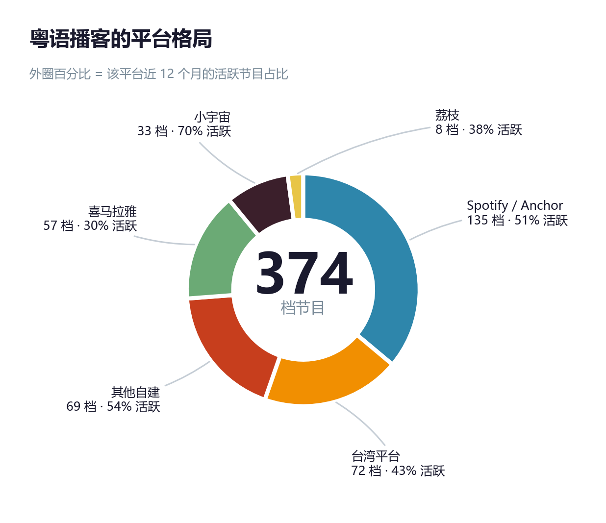
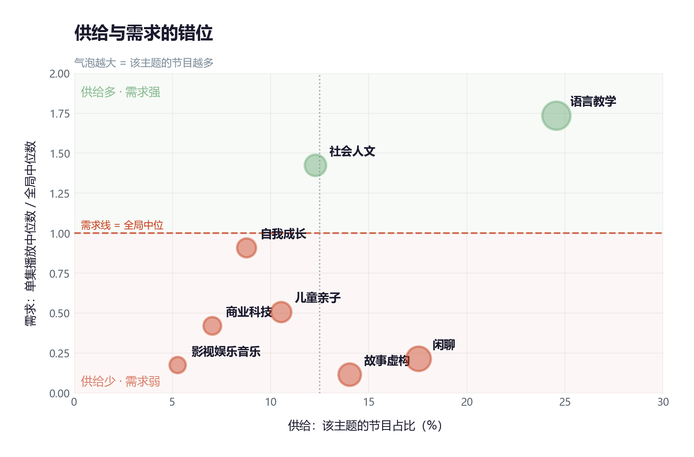
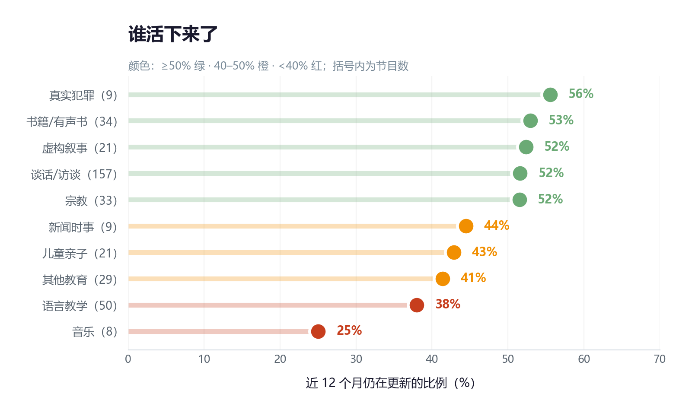

# 粤语播客生态研究

**[→ 项目展示页](https://kevinsssss-boop.github.io/projects/cantonese-podcast.html)**　·　**[→ 源码](https://github.com/Kevinsssss-boop/yu-yue-podcast-research)**

**用 374 档节目、46,721 集单集和 1.36 万条播放数据，描绘一个没人系统研究过的内容生态。**

以苹果播客目录为抽样框采集全量粤语播客，以喜马拉雅播放量作为需求代理，
在同一套主题框架下同时测量「市场在生产什么」和「听众在消费什么」。

---

## 核心发现

| # | 发现 | 数字 |
|:--:|------|------|
| **1** | **过半节目已经死了** | 51% 近 12 个月未更新，19.5% 活不过 10 集，停更中位时长 43 个月 |
| **2** | **供给在朝需求的反方向扩张** | 谈话类节目 10 年从 4 档涨到 90 档（占活跃六成），单集播放却只有全局中位数的 **0.22 倍** |
| **3** | **播放量赢家通吃** | 57 档节目中，前 3 档吃掉 **86.6%** 的总播放 |
| **4** | **唯一的赢家不像媒体** | 语言教学中位时长 **1 分钟**、存活率 **39%**——它是工具，不是节目 |

> 粤语播客是一个被「教粤语」这一功能需求撑起来的生态。
> 真正的消费集中在一个不像媒体的赛道上，而数量最多、增长最快的部分，几乎无人收听。

---

## 图表

### 平台格局：五个互不相通的圈子，73.8% 在境外



### 供给与需求的错位：做的人最多的，恰是听得最少的



### 谁活下来了



### 粤语播客在讲什么


<details>
<summary><b>展开查看全部 15 张图</b></summary>

| 图 | 内容 |
|---|---|
| [内容形态](04-图表/v3/02-内容形态.png) | 树图：谈话类占 42% |
| [年度产出](04-图表/v3/03-年度产出.png) | 堆叠面积：2020 年跃迁、2025 年新高 |
| [形态演化](04-图表/v3/04-形态演化.png) | 各形态活跃节目数 |
| [存活 × 集数](04-图表/v3/06-存活-集数.png) | 1–9 集存活 26%，300+ 存活 82% |
| [集数长尾](04-图表/v3/07-集数长尾.png) | 对数分布与累积曲线 |
| [时长分布](04-图表/v3/08-时长分布.png) | 小提琴图：语言教学中位 1 分钟 |
| [播放集中度](04-图表/v3/09-播放集中度.png) | 帕累托图：前 3 档 = 86.6% |
| [样本偏差](04-图表/v3/11-样本偏差.png) | 蝴蝶图：喜马拉雅把语言教学高估 2.5 倍 |
| [主题平台热力](04-图表/v3/13-主题平台热力.png) | 各平台选题偏好差异 |
| [形态雷达](04-图表/v3/14-形态雷达.png) | 五大形态四维画像 |
| [主题播放箱线](04-图表/v3/15-主题播放箱线.png) | 各主题单集播放分布 |

</details>

---

## 数据是怎么来的

### 抽样框：为什么用苹果播客

播客没有统一目录。喜马拉雅、小宇宙、Spotify 各自封闭，唯一跨平台的公开索引是苹果播客目录——
任何走标准 RSS 的节目都会因主播提交而进入该目录。

通过 [iTunes Search API](https://performance-partners.apple.com/search-api) 检索：

```
https://itunes.apple.com/search?term={关键词}&entity=podcast&country={地区}&limit=100
```

| 维度 | 取值 | 为什么 |
|------|------|------|
| 关键词 | 粤语、廣東話、广东话、Cantonese、粤语播客、廣播劇、栋笃笑 | 前四组常规表述，后三组覆盖圈层用语 |
| 地区 | cn / hk / tw / us | **必须跨区**：香港、台湾商店的节目在 cn 商店不可见 |
| 实体 | podcast | 检索节目名、简介、主播 |

拿到节目列表和 RSS 地址后，逐条请求 RSS 解析出单集。
共获得 **450 档节目 / 51,032 集**。

### 语言判定

苹果目录里有大量「普通话节目顺带提一句粤语」的噪声，因此逐条判定：

- **显式声明**：出现 粤语 / 粵語 / 广东话 / 廣東話 / Cantonese
- **特征字**：出现 嘅、咁、係、喺、唔、嗰、啲、嘢、乜、睇、冇、咗、哋、佢、畀、嚟

命中任一即判为粤语。最终 **374 档保留，74 档剔除**。

### 需求侧：为什么只有喜马拉雅

播放量不是公开数据。测试了四个平台：

| 平台 | 情况 | 结论 |
|------|------|------|
| **喜马拉雅** | 播放量在专辑页列表直接可见，可全量采集 | ✅ 采用（57 档 / 13,595 集） |
| 小宇宙 | 可见，但每档只展示最新 15 期，每集评论上限 20 条 | ❌ 数据截断 |
| B 站 / 小红书 | 非播客平台，内容多为衍生推荐 | ❌ 分析单元不匹配 |
| Spotify / Anchor | 不公开播放量 | ❌ 无数据 |

### 一个特殊的技术坑：繁简转换会改坏粤语字

通用的 OpenCC `t2s` 规则为普通话设计，转换粤语文本时会系统性改坏粤语字：

```
係（粤语"是"） → 系（"系统"）        ← 语义错误
嗰 → 𠮶（扩展区生僻字）              ← 字体不支持、分词失败
餸 → 𩠌 / 孻 → 𡥧 / 躝 → 𨅬
```

本项目的做法是**转换前后双重保护**：转换前用私用区占位符护住歧义字，
转换后扫描全部扩展区字符并自动回填原字（不依赖手工词表，
自动扫描 CJK 基本区 + 扩展 A 区 + 扩展 B 区，生成 1,245 条映射）。

在 102,064 个字段上实测，仅残余 2 个未修复字符。实现见 [`03-脚本/cy_utils.py`](03-脚本/cy_utils.py)。

---

## 方法

| 环节 | 做法 |
|------|------|
| 分类 | **形式**（怎么讲，覆盖 374 档）+ **主题**（讲什么，用于供需矩阵） |
| 主题体系 | 参考小宇宙 19 类、CPA 19 类、嘉世 6 类，合并为 9 类 |
| 需求口径 | 原始中位数 / 月均播放 / 近 12 个月，三口径交叉验证 |
| 稳健性 | 主题标签铺到全样本，检验需求侧样本的代表性 |

**为什么不用总量而用中位数**：播放量呈极端偏态（前 3 档占 86.6%），
用总量衡量某个主题的受欢迎程度，实际测到的是「该主题里有没有爆款」。

**为什么需要三口径**：播放量是累计值。老节目攒了六年，新节目只攒了三个月，
直接比较必然偏向老节目。三个口径各有偏差，只采纳三者一致的结论。

---

## 目录结构

```
yu-yue-podcast-research/
├── 00-研究设计.md              研究设计与字段清单
├── 01-原始数据/                采集原始输出（体积大，不入库）
├── 02-清洗后数据/              清洗后的节目表与单集表
├── 03-脚本/                    18 个可重跑的 Python 脚本 + 运行说明
├── 04-图表/                    v1 / v2 / v3 三代图表，README 引用 v3
├── 05-打标/                    语言判定工作台
├── 06-听众侧/                  喜马拉雅播放量与清洗结果
├── 07-分析/                    描述统计、供需矩阵、存活演化的明细
├── 08-分析报告.md              报告正文（Markdown 简版）
├── 粤语播客生态研究报告.docx     完整研究报告
├── 数据说明.md                  入库/未入库文件清单
├── README.md / LICENSE / requirements.txt
└── .gitignore
```

---

## 复现

原始单集表（70 MB / 46 MB）因体积与内容版权未纳入仓库。
完整流程可从头跑通：

```bash
pip install -r requirements.txt   # jieba / openpyxl / matplotlib / wordcloud / squarify / python-docx / opencc

python 03-脚本/01-采集粤语播客.py        # 采集内容侧（约 40 分钟）
python 03-脚本/03-清洗数据.py            # 清洗 → 374 档 / 46,721 集
python 03-脚本/08-描述统计.py            # 描述统计
python 03-脚本/11-存活与演化.py          # 生存分析
python 03-脚本/10-主题供需矩阵.py        # 供需矩阵
python 03-脚本/17-作品集图表v3.py        # 生成全部图表（v3）
python 03-脚本/16-生成Word报告v2.py      # 生成 Word 报告
```

需求侧数据需通过浏览器自动化从喜马拉雅采集，脚本为 `03-脚本/05-清洗喜马拉雅播放量.py`（清洗部分）。

---

## 已知局限

| 编号 | 局限 | 影响 |
|:--:|------|------|
| L1 | 需求侧仅覆盖喜马拉雅单平台 | 需求结论不能外推至全生态 |
| L2 | 需求侧样本存在主题偏斜 | 语言教学占比高估 2.5 倍，宗教类完全缺失 |
| L3 | 内容侧依赖 RSS | 长播节目的早期单集不在 RSS 中，集数被低估 |
| L4 | 播放量为累计值 | 三重口径仍有残余不确定性 |
| L5 | 主题标注为混合方法 | 317 档由规则判定，准确率约 75% |
| L6 | 存活率为横截面测量 | 存在右删失，不能得出「新节目更持久」 |

详见报告第七章第 4 节。

---

## 许可

代码与文档采用 [MIT License](LICENSE)。

数据部分：节目元数据来自公开 RSS 与公开网页，仅用于研究用途；
原始单集文本未纳入仓库。

---

## 报告

完整研究报告见 [`粤语播客生态研究报告.docx`](粤语播客生态研究报告.docx)，
约 30 页，含 15 图 26 表。
